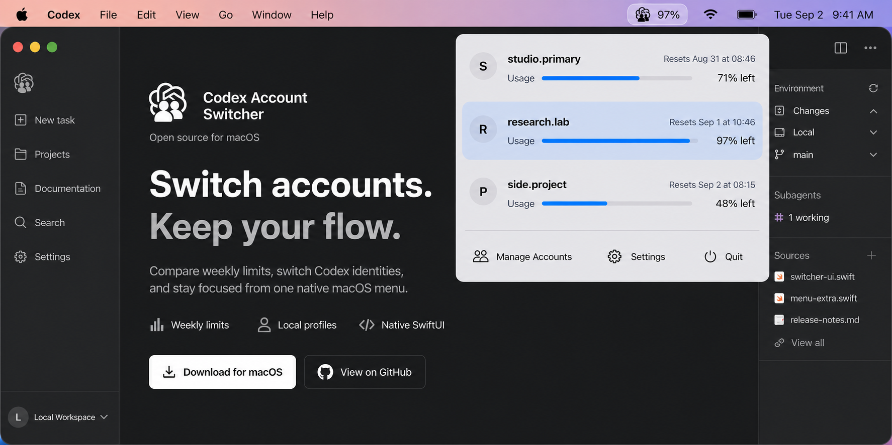

<p align="center">
  <picture>
    <source media="(prefers-color-scheme: dark)" srcset="assets/account-switcher-logo-white.png">
    
  </picture>
</p>

<h1 align="center">Codex Account Switcher</h1>

<p align="center">
  <strong>Switch Codex accounts on macOS and Windows.</strong><br>
  Add accounts once, then choose when you need them. No Terminal commands or config-file editing.
</p>

<p align="center">
  <a href="https://github.com/liuzhao1225/codex-account-switcher/releases"></a>
  
  
  
  <a href="LICENSE"></a>
</p>

<p align="center">
  <a href="https://github.com/liuzhao1225/codex-account-switcher/releases/latest/download/Codex-Account-Switcher-macos-arm64.dmg"><b>Download free for Mac</b></a> ·
  <a href="https://github.com/liuzhao1225/codex-account-switcher/releases/latest/download/Codex-Account-Switcher-windows-x64.exe"><b>Download free for Windows</b></a> ·
  <a href="https://liuzhao1225.github.io/codex-account-switcher/"><b>Website</b></a> ·
  <a href="https://github.com/liuzhao1225/codex-account-switcher/discussions"><b>Discussions</b></a>
</p>

<p align="center">
  English · <a href="README.zh-CN.md">中文</a>
</p>



<p align="center">Created and maintained by <a href="https://liuzhao1225.github.io/codex-account-switcher/about/creator/">Zhao Liu (GitHub: liuzhao1225)</a> · <a href="https://x.com/liuzhao_666">X</a> · <a href="https://space.bilibili.com/1263732318">Bilibili</a></p>

Codex Account Switcher is a free, open-source native app for managing multiple authorized Codex accounts on macOS and Windows. Add personal, work, or client accounts through browser sign-in once, then switch accounts from the macOS menu bar or Windows system tray.

When you confirm a switch, the app closes Codex Desktop (if installed and running), updates `~/.codex/auth.json` atomically, verifies the target identity, and reopens Codex Desktop. CLI-only setups without Codex Desktop installed also switch cleanly. Saved account profiles stay local on your computer.

## Download

Get the [latest unified release](https://github.com/liuzhao1225/codex-account-switcher/releases/latest) with SHA-256 checksums:

| Platform | Requirements | Download and install |
| --- | --- | --- |
| macOS | macOS 14+, Apple Silicon (arm64) | [Download DMG](https://github.com/liuzhao1225/codex-account-switcher/releases/latest/download/Codex-Account-Switcher-macos-arm64.dmg), open it, and drag the app to Applications |
| Windows | Windows 10/11, x64 | [Download EXE](https://github.com/liuzhao1225/codex-account-switcher/releases/latest/download/Codex-Account-Switcher-windows-x64.exe) and run it; no separate .NET or Swift SDK required |

### First launch on macOS for fork releases

This fork's macOS DMG uses ad hoc signing. If macOS blocks the first launch, verify that you downloaded the DMG from this fork before continuing. [Fork releases](https://github.com/4379711/codex-account-switcher/releases)

1. Open the DMG, drag **Codex Account Switcher** to **Applications**, then try opening the app from there.
2. Go to **System Settings → Privacy & Security**, scroll to **Security**, and click **Open Anyway**.
3. Click **Open** in the confirmation dialog. macOS saves an exception for this app, so you can open it normally next time.

[Apple's guide to opening apps on Mac](https://support.apple.com/en-us/102445)

## Features

| Feature | Details |
| --- | --- |
| **Browser sign-in & local registration** | Add new accounts via Codex's browser login flow or register the currently active `~/.codex/auth.json` login. |
| **Safe Desktop & CLI handoff** | Closes Codex Desktop, saves the previous credential, installs and verifies the target credential, and reopens Desktop (or switches `auth.json` directly for CLI-only users). Restores the previous credential if verification fails. |
| **Usage & reset tracking** | Displays 7-day usage by default, optional exact 5-hour usage, selectable status-bar/tray percentage window, and remaining banked reset counts. |
| **Live subscription dates** | Refreshes subscription validity, renewal, and delinquency details on both macOS and Windows, with inactive-account 401 token recovery and local caching. |
| **Automatically use reset cards** | Opt-in automation that checks and consumes expiring `codexRateLimits` reset credits across saved accounts 10, 5, and 1 minute before expiry, backed by a bounded crash-resilient local log. |
| **Drag-and-drop ordering & localization** | Reorder saved accounts in Manage Accounts; supports System Default, English, Simplified Chinese, and Italian. |

## Privacy & Architecture

- Saved profiles live in `~/Library/Application Support/Codex Account Switcher/` on macOS (`0700` directories, `0600` files) and `%LOCALAPPDATA%\Codex Account Switcher\` on Windows (current-user ACLs).
- Every `codex app-server` session runs with file-backed credentials (`cli_auth_credentials_store="file"`) and disables background plugin/app sync (`features.plugins=false`, `features.remote_plugin=false`, `features.apps=false`, `features.shell_snapshot=false`) so profile folders stay lightweight.
- Idle quota sessions expire after 90 seconds, releasing child processes between 5-minute background polls while reusing warm sessions during active UI interactions.
- No developer-operated proxy, telemetry, or third-party forecast polling is included.

## Development

```bash
git clone https://github.com/liuzhao1225/codex-account-switcher.git
cd codex-account-switcher
./scripts/run-tests.sh
./scripts/package-local-app.sh
```

### Project layout

```text
Sources/CodexAccountSwitcher/   Native macOS SwiftUI menu-bar app and AppKit/Sparkle adapters
Sources/SwitcherCore/           Shared account store, controller, switching, RPC, subscription & auto-reset
Sources/SwitcherHost/           Typed single-pass JSON stdio host for the Windows client
Sources/SwitcherPlatform/       Win32 private ACLs, extended-path cleanup, and atomic writes
windows/                        Native Windows WPF/tray client, adapters, and UI/integration checks
Tests/                          Unified Swift Testing suite (core, transport, live subscriptions, macOS UI)
scripts/                        Test runner, local packaging, and release verification scripts
docs/                           Architecture, shared-core protocol, testing, and release documentation
```

## Documentation

- [Documentation index](docs/README.md)
- [System design](docs/system-design.md)
- [Shared core & Windows host](docs/shared-core.md)
- [Testing](docs/testing.md)
- [Platform releases](docs/platform-releases.md)

## License

Released under the [MIT License](LICENSE). Independent open-source project; not affiliated with or endorsed by OpenAI.
