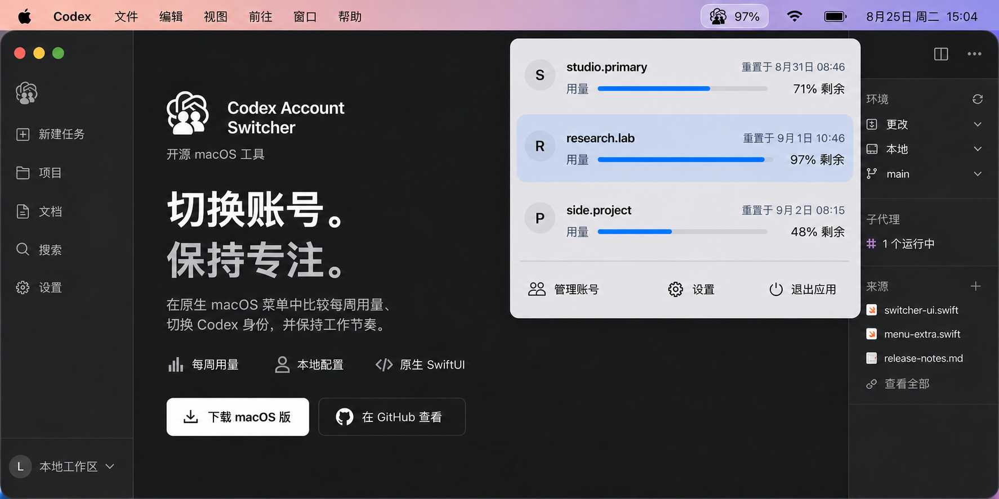

<p align="center">
  <picture>
    <source media="(prefers-color-scheme: dark)" srcset="assets/account-switcher-logo-white.png">
    
  </picture>
</p>

<h1 align="center">Codex Account Switcher</h1>

<p align="center">
  <strong>在 macOS 与 Windows 上轻松切换多个 Codex 账号。</strong><br>
  一次浏览器登录添加账号，随时一键确认切换，无需敲命令或手改配置文件。
</p>

<p align="center">
  <a href="https://github.com/4379711/codex-account-switcher/releases/latest"></a>
  
  
  
  <a href="LICENSE"></a>
</p>

<p align="center">
  <a href="https://github.com/4379711/codex-account-switcher/releases/latest/download/Codex-Account-Switcher-macos-arm64.dmg"><b>免费下载 Mac 版</b></a> ·
  <a href="https://github.com/4379711/codex-account-switcher/releases/latest/download/Codex-Account-Switcher-windows-x64.exe"><b>免费下载 Windows 版</b></a> ·
  <a href="https://liuzhao1225.github.io/codex-account-switcher/zh-CN/"><b>项目官网</b></a> ·
  <a href="https://github.com/liuzhao1225/codex-account-switcher/discussions"><b>交流讨论</b></a>
</p>

<p align="center">
  <a href="README.md">English</a> · 中文
</p>



<p align="center">由 <a href="https://liuzhao1225.github.io/codex-account-switcher/zh-CN/about/creator/">刘朝 Zhao Liu (GitHub: liuzhao1225)</a> 创建与维护 · <a href="https://x.com/liuzhao_666">X</a> · <a href="https://space.bilibili.com/1263732318">Bilibili</a></p>

Codex Account Switcher 是一款免费开源的 macOS 与 Windows 原生多账号切换工具。通过浏览器登录保存你的个人、工作或授权客户账号后，即可在 macOS 菜单栏或 Windows 系统托盘中查看额度并安全切换。

确认切换时，应用会关闭运行中的 Codex Desktop，原子替换 `~/.codex/auth.json` 并校验目标身份，随后重新启动 Codex Desktop；未安装 Codex Desktop 的纯 CLI 环境也能无感切换。所有账号数据仅保存在本机。

## 下载安装

在本 fork 的最新 Release 中可以下载两个平台的安装包和 SHA-256 校验文件。[查看最新 Release](https://github.com/4379711/codex-account-switcher/releases/latest)

| 平台 | 系统要求 | 下载与安装 |
| --- | --- | --- |
| macOS | macOS 14+，Apple Silicon (arm64) | [下载 DMG](https://github.com/4379711/codex-account-switcher/releases/latest/download/Codex-Account-Switcher-macos-arm64.dmg)，打开后拖入“应用程序” |
| Windows | Windows 10/11，x64 | [下载便携版 EXE](https://github.com/4379711/codex-account-switcher/releases/latest/download/Codex-Account-Switcher-windows-x64.exe) 直接运行，无需额外安装 .NET 或 Swift 运行时 |

### Fork 版 macOS 安装包首次启动

本 fork 发布的 macOS DMG 使用 ad hoc 签名。如果 macOS 拦截首次启动，请先确认 DMG 来自本 fork 再继续。[Fork 发布页](https://github.com/4379711/codex-account-switcher/releases)

1. 打开 DMG，将 **Codex Account Switcher** 拖入「应用程序」，然后在「应用程序」中尝试打开它。
2. 前往 **系统设置 → 隐私与安全性**，向下滚动到「安全性」，点击 **仍要打开**。
3. 在弹窗中点击 **打开**。macOS 会为这份 App 保存例外，下次可以直接双击打开。

[Apple 官方打开说明](https://support.apple.com/zh-cn/102445)

如果你在任一平台使用 `v0.2.2` 或更早版本，请手动安装一次较新的 fork 版本，应用内更新就会切换到本 fork。

## 核心功能

| 功能 | 说明 |
| --- | --- |
| **浏览器登录与一键登记** | 支持标准 Codex 浏览器登录添加新账号，或直接登记当前 `~/.codex/auth.json` 登录状态。 |
| **安全切号与自动回滚** | 依次完成关闭 Desktop、保存原凭证、原子写入目标凭证、核验身份与重开 Desktop（纯 CLI 用户直接切换凭证）；验证失败自动恢复原账号。 |
| **额度与重置次数展示** | 默认展示 7 天额度，可选开启精确 5 小时额度行，支持自定义状态栏/托盘显示窗口（5 小时或 7 天）及剩余 reset 次数。 |
| **双端实时订阅状态** | macOS 与 Windows 均支持从订阅服务刷新真实有效至日期、自动续费与欠费状态，并在非活动账号遇到 401 时安全续期令牌。 |
| **自动使用重置卡** | 可选开启自动化，在 `codexRateLimits` 重置卡到期前 10、5、1 分钟检查并尝试使用，采用有界抗损坏的本地 `auto-reset.jsonl` 日志。 |
| **拖拽排序与多语言** | 支持在“管理账号”中拖拽调整顺序；内置跟随系统、English、简体中文与 Italiano。 |

## 隐私与工程边界

- 本地数据保存在 macOS `~/Library/Application Support/Codex Account Switcher/`（目录 `0700`、文件 `0600`）与 Windows `%LOCALAPPDATA%\Codex Account Switcher\`（当前用户私有 ACL）。
- 所有 `codex app-server` 子进程均强制指定文件凭证（`cli_auth_credentials_store="file"`）并关闭后台插件/应用同步（`features.plugins=false`、`features.remote_plugin=false`、`features.apps=false`、`features.shell_snapshot=false`），不会污染系统钥匙串或在快照目录下载插件仓库。
- 配额会话空闲 90 秒后自动退出回收内存，在 5 分钟定时轮询之间不保留常驻僵尸进程。
- 无开发者自有代理服务器、无遥测上报、无第三方预测网站后台轮询。

## 本地开发

```bash
git clone https://github.com/liuzhao1225/codex-account-switcher.git
cd codex-account-switcher
./scripts/run-tests.sh
./scripts/package-local-app.sh
```

更多架构与发版说明见 [docs/README.md](docs/README.md)。

## 开源许可

基于 [MIT License](LICENSE) 开源。独立社区项目，与 OpenAI 无隶属或背书关系。
